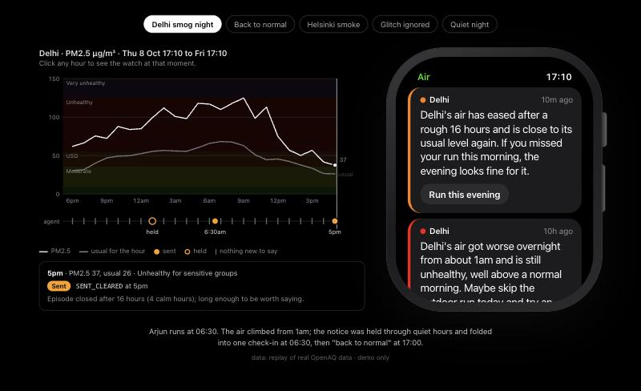

# Watch demo

A small, demo-only web app that shows the air quality agent's notifications the way a person would meet them: on a smartwatch, with the data behind them laid out beside it.

The page has two halves. On the right is the watch. Everything inside it is the product: a stack of short notices, newest first, each with one suggested action, and a "Why you got this" view behind every notice. On the left is a chart of what the agent actually saw: the station's hourly PM2.5, the usual level for each hour of the day, the official air quality bands behind them, and a lane underneath with one mark for every hour the agent decided something: a filled dot where it sent a message, a ring where it held one for later, a small tick where it had nothing new to say.

Click any hour on the chart and the watch jumps to that moment. In the Delhi scenario, 1am shows the watch in quiet hours with something held; 6:30am shows the single check-in message arriving; 5pm shows the all-clear. Below the chart, a short line names the decision for that hour and the reason the agent recorded. Everything outside the watch (the chart, the scenario chips, the description and a note that the data is a replay of real OpenAQ readings) is the demo frame.



## Why it exists

The agent's job is to speak rarely and well. A dashboard of decisions shows that it reasons; a watch face shows what that reasoning feels like on the receiving end: one calm message in the morning instead of six alarms overnight, an all-clear when the air recovers, and nothing at all when a sensor glitches.

It is deliberately separate from the agent itself. It never imports the agent's code. It either asks the running agent for its data over HTTP, or reads a set of example files shaped exactly like the agent's responses, so it runs offline with no API key.

## Running it

From the repository root:

```bash
uv run --project apps/watch_demo watch-demo
```

Then open http://localhost:8100. With no further setup it reads the example files in `fixtures/`. To point it at a running agent instead, set `AQAGENT_API_URL`, for example `AQAGENT_API_URL=http://localhost:8000`.

The tests run with:

```bash
uv run --project apps/watch_demo pytest apps/watch_demo/tests
```

## The scenarios

Sixteen scenarios, grouped by what they show. Each one opens with a question, a few tags naming the capabilities involved, and two to four numbered beats. Click a beat, or step hour by hour, and the watch moves to that moment. Under the chart, a panel says in plain words what the agent decided at that moment, shows the layer-by-layer path it took, and gives the reason code.

- **When it speaks.** Delhi smog night (held overnight, one check-in, then an all-clear); Back to normal; Sudden spike (a jump to very unhealthy sent at once); Severe night (very unhealthy air at 2:50am breaks through quiet hours); Slow build-up (Los Angeles stuck a little above normal for days: one message).
- **When it stays quiet.** Quiet night; All day bad, one message (Dubai, twelve unhealthy hours, one message); Too soon to repeat (pacing); Gone by morning (a held message dropped because the problem passed); Blip, no all-clear; Unusual but harmless (the detector fires, but the air is still good).
- **When the data can't be trusted.** Glitch ignored; Too short to tell (one high hour between two normal ones); Sensor went silent (no data, so nothing is said, and the story closes quietly after a day).
- **Same air, different person.** Helsinki smoke (six times the usual, still "Moderate", and Aino is sensitive); Two people, one city (Meera hears, Arjun doesn't).

The "What it can do" page lists every capability with the part of the brief it answers and links to the scenarios that show it. The one capability no scenario shows is the daily message budget: in ninety days of replay it never had to step in.

Everything is real. The fixtures are exported from a replay of the 90-day sample (`scripts/export_watch_fixtures.py`), and every beat sits on a decision the replay actually made; the export stops if one doesn't.

## Screenshots

The `screenshots/` folder has each scenario and its "Why" view, plus two moments from the Delhi night (1am, held; 6:30am, the check-in), taken from the running app.

## What it is not

It is not a product front end. There is no login, no settings, and no live updating; it replays recorded moments. It also uses no JavaScript: the chart is drawn on the server, and every hour on it is an ordinary link.
